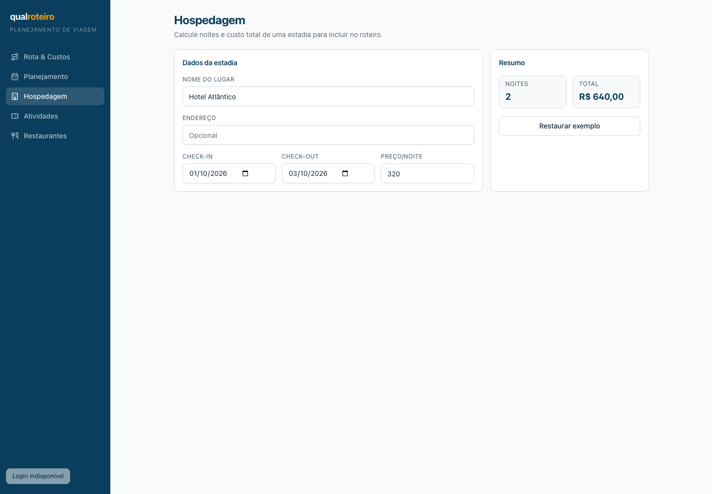
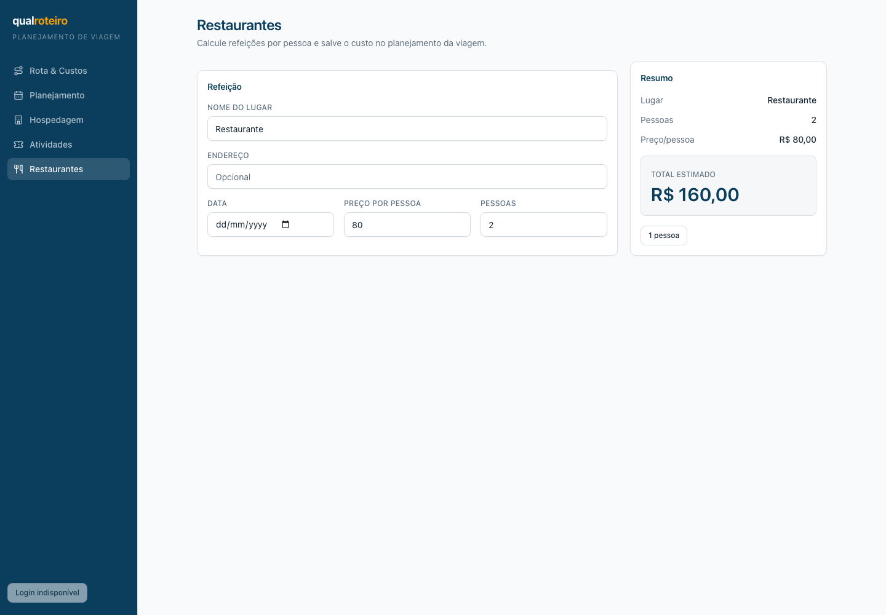

# Revisão de front-end — 2026-09-16

**Escopo:** Rota & Custos, Planejamento de Viagem, Hospedagem, Restaurantes e
Atividades. Revisão de leitura: nenhuma alteração de código, commit ou PR.

## Método e ambiente

- App real local: API em `http://localhost:3001`, web em `http://127.0.0.1:5174`,
  com Postgres local já em execução; sem fixtures, mocks ou modo demonstração.
- Navegador: Chromium via Playwright 1.63.0, desktop 1440×1000 e mobile 390×844.
- Base revisada: `73c7d51380d91f5e6940be8c28fc3767e07b943a` (2026-09-16).
- Evidências em [`evidence/`](evidence/). A sessão e o inventário de foco foram
  salvos fora do repositório em `/private/tmp/frontend-review.json`.

Limite conhecido: o ambiente real apresentou o botão desabilitado **“Login
indisponível”**. Portanto, Planejamento foi verificado no estado público real
(empty state); a lista, criação, detalhe e reordenação autenticados não puderam
ser exercitados sem criar uma sessão/conta, o que ficaria fora do escopo sem
mocks desta revisão.

## Resumo

| Prioridade | Resultado |
| --- | --- |
| Acessibilidade | 1 achado **importante**; teclado, foco e nomes dos controles visíveis passam na jornada pública. |
| Prontidão para dark mode | Tokens semânticos cobrem a maior parte do app, mas há **17 declarações hardcoded** em 5 arquivos/áreas; não está pronta para inverter tema sem tratá-los. |
| Consistência de layout | 1 achado **cosmético** confirmado: Restaurantes não compartilha o container/padding/tipografia dos dois módulos-calculadora irmãos. |

Não houve achado bloqueante. Todos os achados abaixo já existiam antes desta
revisão: os trechos responsáveis têm autoria de 2026-09-15 no `git blame` e
estão presentes na base inicial auditada.

## Achados

### A11Y-01 — Erros das calculadoras não são anunciados nem associados ao campo

**Severidade: importante. Existia antes desta revisão: sim.**

Ao informar valor inválido no app real, o erro é visualmente percebível, mas:

- `#lodging-price` com `-1` mostra `pricePerNight must be non-negative`;
- `#activity-people` com `0` mostra `people must be at least 1`;
- `#restaurant-people` com `0` mostra `Informe pelo menos uma pessoa.`

Nos três casos o `
` de erro não tem `role="alert"`/`aria-live`, o input não
recebe `aria-invalid` nem `aria-describedby`, e o texto não é posicionado junto
ao campo que falhou. Isso depende de cor e de varredura visual do painel
“Resumo”; leitores de tela não recebem anúncio confiável. Hospedagem e
Atividades ainda expõem mensagem interna em inglês para usuário final.

**Evidência Playwright:**

| Hospedagem | Atividades | Restaurantes |
| --- | --- | --- |
| [print: preço -1](evidence/hospedagem-validation.png) | [print: pessoas 0](evidence/atividades-validation.png) | [print: pessoas 0](evidence/restaurantes-validation.png) |

**Seletores / arquivos exatos:** `#lodging-price` e bloco de erro em
[`apps/web/src/modules/hospedagem/index.tsx:107`](../../../apps/web/src/modules/hospedagem/index.tsx:107)
e [`:136`](../../../apps/web/src/modules/hospedagem/index.tsx:136);
`#activity-people` e erro em
[`apps/web/src/modules/atividades/index.tsx:109`](../../../apps/web/src/modules/atividades/index.tsx:109)
e [`:135`](../../../apps/web/src/modules/atividades/index.tsx:135);
`#restaurant-people` e erro em
[`apps/web/src/modules/restaurantes/index.tsx:108`](../../../apps/web/src/modules/restaurantes/index.tsx:108)
e [`:145`](../../../apps/web/src/modules/restaurantes/index.tsx:145).

**Contraste:** o vermelho semântico `--destructive` sobre `bg-destructive/10`
mede aproximadamente **4,75:1**, portanto a falha não é de contraste; é de
semântica, associação e linguagem da mensagem.

### LAYOUT-01 — Restaurantes foge do container padrão de calculadoras

**Severidade: cosmético. Existia antes desta revisão: sim.**

O achado do PE foi confirmado visualmente em 1440 px. Hospedagem e Atividades
usam o mesmo section `max-w-5xl` com padding interno `md:px-8`, header externo
e grade `..._20rem`. Restaurantes põe o padding no section externo e a grade
`max-w-5xl` sem padding interno; por isso o conteúdo começa 32 px mais à
esquerda e termina 32 px mais à direita. Também põe título/descrição dentro da
primeira coluna, aplica `font-semibold` (em vez de `font-bold`) e usa
`mt-1` (em vez do `gap-1` dos irmãos). A coluna de resumo tem a mesma largura
efetiva (320 px = `20rem`), mas o DOM e o alinhamento não são irmãos.

| Hospedagem — padrão dos irmãos | Restaurantes — estrutura divergente |
| --- | --- |
|  |  |
| [`Atividades`, mesma estrutura de Hospedagem](evidence/atividades-desktop.png) | resumo também é `sticky` com `lg:pt-[76px]` |

**Arquivos exatos:** padrão em
[`apps/web/src/modules/hospedagem/index.tsx:53`](../../../apps/web/src/modules/hospedagem/index.tsx:53)
e [`apps/web/src/modules/atividades/index.tsx:53`](../../../apps/web/src/modules/atividades/index.tsx:53);
divergência em
[`apps/web/src/modules/restaurantes/index.tsx:49`](../../../apps/web/src/modules/restaurantes/index.tsx:49),
[`apps/web/src/modules/restaurantes/index.tsx:50`](../../../apps/web/src/modules/restaurantes/index.tsx:50),
[`apps/web/src/modules/restaurantes/index.tsx:53`](../../../apps/web/src/modules/restaurantes/index.tsx:53) e
[`apps/web/src/modules/restaurantes/index.tsx:124`](../../../apps/web/src/modules/restaurantes/index.tsx:124).

### Não é achado — `max-w-3xl` de Planejamento é intencional

No estado público real, Planejamento apresenta uma tela de entrada/empty state
centralizada, sem formulário denso ou resumo lateral. Esse caso usa
`max-w-3xl`; as telas autenticadas de lista e detalhe usam `max-w-5xl`, como
os módulos de trabalho. A diferença acompanha o propósito visual e não foi
classificada como inconsistência.

**Evidência:** [desktop de Planejamento](evidence/planejamento-desktop.png).
**Arquivo:** [`apps/web/src/modules/planejamento-viagem/index.tsx:155`](../../../apps/web/src/modules/planejamento-viagem/index.tsx:155)
versus [`:223`](../../../apps/web/src/modules/planejamento-viagem/index.tsx:223)
e [`:399`](../../../apps/web/src/modules/planejamento-viagem/index.tsx:399).

## Acessibilidade — verificações que passaram

- **Teclado e foco:** em cada módulo público, `Tab` segue navegação lateral
  → controles da tela em ordem DOM. O navegador expôs outline visível nos
  links da navegação e os `Input`/`Select`/`Button` do design system aplicam
  `focus-visible:ring-2`; a sessão confirmou foco visível em links, campos,
  selects e botões. Os campos de data recebem subcampos do controle nativo,
  comportamento esperado do Chromium, não uma repetição da aplicação.
- **Nomes:** todos os inputs públicos foram localizados por `getByLabel()`
  (incluindo origem/destino, veículo e os três formulários). Links de módulo
  têm texto; ações por ícone visíveis no mapa têm `aria-label` (“Zoom in” e
  “Zoom out”); o botão de remover parada é nomeado dinamicamente em
  [`NewQueryScreen.tsx:231`](../../../apps/web/src/modules/rota-custos/NewQueryScreen.tsx:231).
  Não apareceu botão/link visível sem nome acessível na inventariação.
- **Rota & Custos:** ao submeter vazio, `#origin`/`#destination` recebem
  `aria-invalid="true"`, apontam por `aria-describedby` a `#origin-error` /
  `#destination-error`, ambos com `role="alert"`. [Print de validação](evidence/rota-custos-validation.png).
- **Contraste dos textos e status principais:** cálculo a partir dos tokens
  CSS atuais: foreground/background **15,11:1**; primary/background
  **10,82:1**; muted foreground/background **5,02:1**; texto do CTA
  accent **7,84:1**; status “modo demonstração” amber **8,97:1**. São todos
  AA para texto normal. Evidência visual de navegação/labels:
  [Rota & Custos desktop](evidence/rotaCustos-desktop.png),
  [Hospedagem mobile](evidence/hospedagem-mobile.png),
  [Restaurantes mobile](evidence/restaurantes-mobile.png).

## Dark mode — inventário de prontidão (não foi implementado)

`rg 'dark:' apps/web/src` retornou zero ocorrências, confirmando que não há
toggle/variante dark hoje. A fundação semântica é boa: `bg-background`,
`text-foreground`, `text-muted-foreground`, `bg-card`, `border-border`,
`ring-ring` e os demais tokens são CSS variables HSL definidas em
[`apps/web/src/index.css:18`](../../../apps/web/src/index.css:18). Uma variante
escura desses tokens atenderia a maior parte dos módulos.

Há, porém, **17 declarações de cor hardcoded** que não acompanhariam a troca de
tokens automaticamente:

| Área | Quantidade | Uso | Arquivo exato |
| --- | ---: | --- | --- |
| Marcadores de mapa | 10 | 5 pares `bg`/`ring` em HSL | [`layers.ts:45`](../../../apps/web/src/core/map/layers.ts:45) |
| Traço/sombra do mapa | 3 | 2 hex + `rgba(0,0,0,.35)` | [`MapCanvas.tsx:69`](../../../apps/web/src/core/map/MapCanvas.tsx:69), [`:154`](../../../apps/web/src/core/map/MapCanvas.tsx:154) |
| Status demo | 2 | `bg-amber-400`, `text-amber-950` | [`AppShell.tsx:70`](../../../apps/web/src/core/shell/AppShell.tsx:70) |
| Atribuição MapLibre | 1 | `!bg-white/80` | [`index.css:70`](../../../apps/web/src/index.css:70) |
| Thumb do toggle de camadas | 1 | `bg-white` | [`PointsPanel.tsx:52`](../../../apps/web/src/modules/rota-custos/panels/PointsPanel.tsx:52) |

**Nota de contagem:** os cinco marcadores têm `bg` e `ring` separados, por isso
somam 10 das 17 declarações. Elas se concentram no mapa/core; os três módulos
calculadora não contêm `bg-white`, `text-black`, hex ou classes de paleta
direta. Antes de ligar dark mode, esse inventário deve migrar para tokens ou
ser explicitamente preservado como cor geográfica de mapa.

## Evidências completas por módulo

| Módulo | Desktop | Mobile |
| --- | --- | --- |
| Rota & Custos | [print](evidence/rotaCustos-desktop.png) | [print](evidence/rotaCustos-mobile.png) |
| Planejamento | [print](evidence/planejamento-desktop.png) | [print](evidence/planejamento-mobile.png) |
| Hospedagem | [print](evidence/hospedagem-desktop.png) | [print](evidence/hospedagem-mobile.png) |
| Restaurantes | [print](evidence/restaurantes-desktop.png) | [print](evidence/restaurantes-mobile.png) |
| Atividades | [print](evidence/atividades-desktop.png) | [print](evidence/atividades-mobile.png) |
