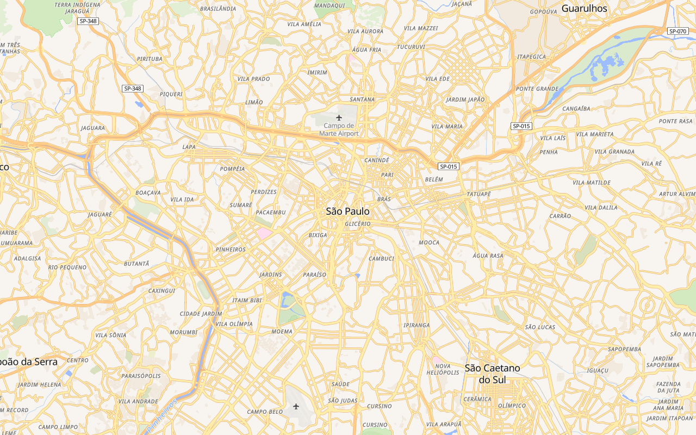
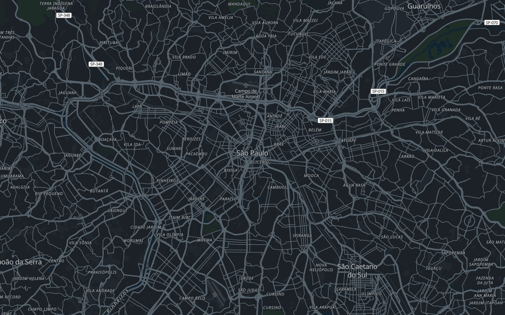
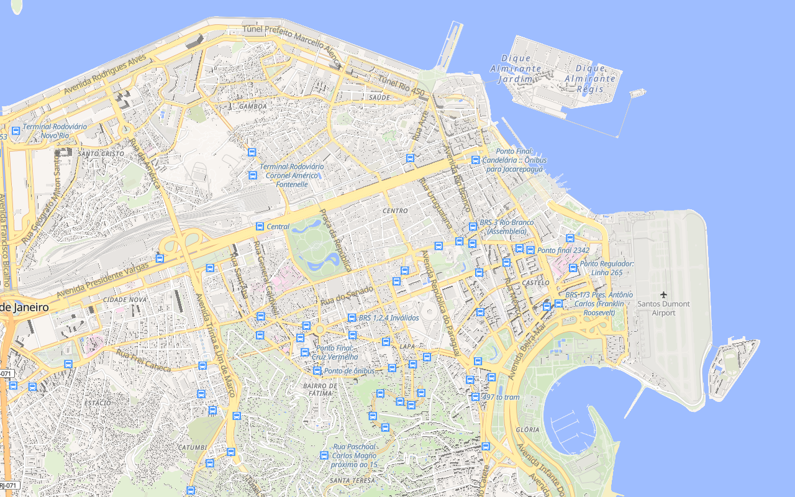
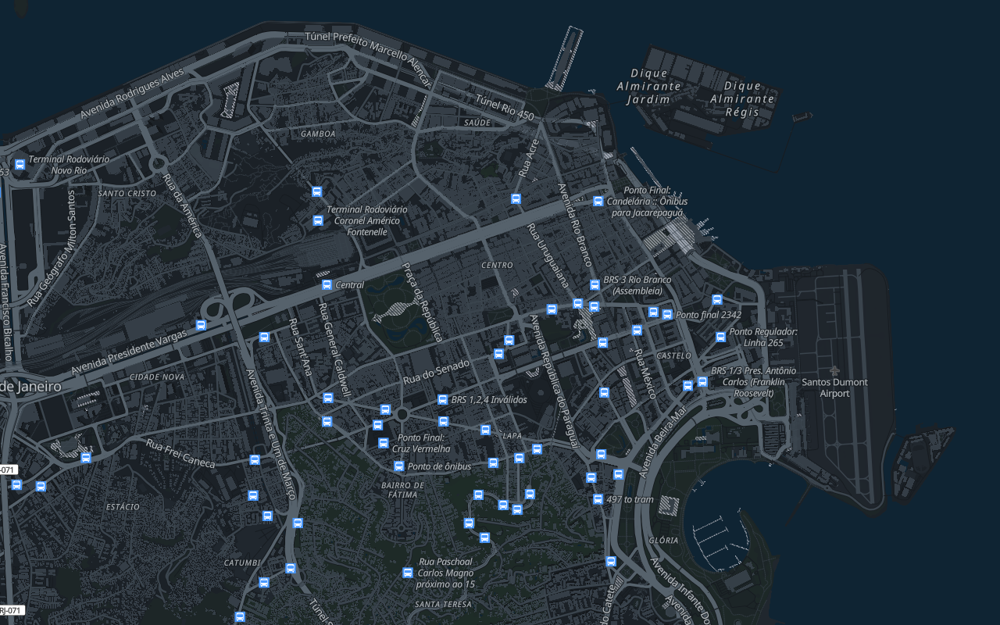
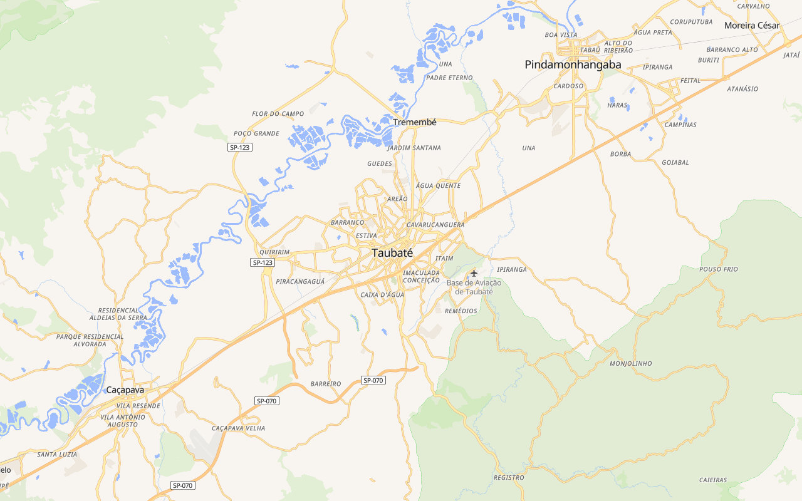
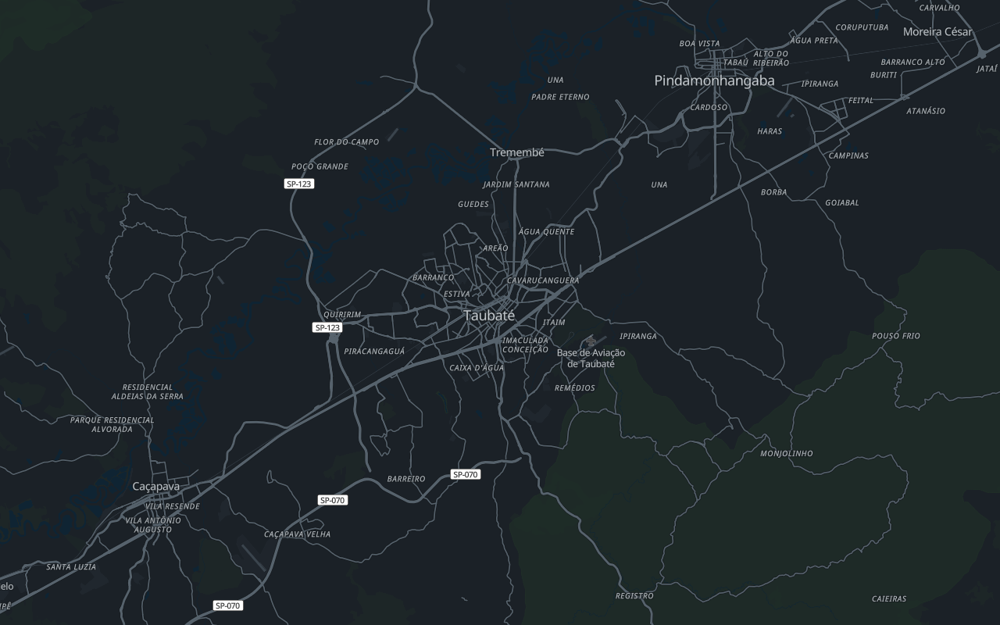

# F0 — Spike: recolorir OpenFreeMap (D3)

- Data: 2026-11-22 · Branch `feat/layout-f0-recolor-spike` · Script: `apps/web/scripts/map-recolor-spike.mjs`
- Estilo: `https://tiles.openfreemap.org/styles/liberty` (111 camadas) · Chrome headless (perfil descartável, `--use-mock-keychain`, SwiftShader) dentro de `agentop run --rm`.

## Veredito: **PASSA**

Recolorir o `liberty` por regra de papel (type / `source-layer` / prefixo do id) produz um mapa escuro coerente em SP, centro do Rio e rodovia, sem tom claro vazando e com rótulos legíveis. F3 pode seguir com `recolorStyle` e remover o filtro CSS `.dark .maplibregl-canvas` (com as ressalvas abaixo).

## Critérios objetivos

| Critério | Limite | Medido | Resultado |
|---|---|---|---|
| Contraste texto do rótulo vs `label-halo` | ≥ 4,5:1 | 13.17:1 | ✅ |
| Contraste texto do rótulo vs pior fundo (land/park/water/road/road-major) | ≥ 4,5:1 | 4.56:1 | ✅ (margem pequena: não escurecer rótulo nem clarear `road-major` sem rever) |
| Vazamento: fração de pixels com luminância > 0,6 no mapa escuro | < 5% em cada captura | máx 1.43% | ✅ |
| Luminância média no escuro | < 0,30 | máx 0.195 | ✅ |

Contraste = razão WCAG calculada sobre as cores resolvidas do estilo recolorido (não há antialias). Pixels: média/fração sobre a captura 1280×800 (inclui rótulos e ícones, então é um teto, não um piso).

| Captura | Luma média | Pixels > 0,6 |
|---|---|---|
| sp-claro | 0.912 | 98.69% |
| rio-claro | 0.835 | 95.62% |
| rodovia-claro | 0.927 | 99.12% |
| sp-escuro | 0.189 | 0.84% |
| rio-escuro | 0.195 | 1.43% |
| rodovia-escuro | 0.150 | 0.60% |

## Capturas (6)

| Local | Claro | Escuro |
|---|---|---|
| São Paulo (Sé, z11,5) |  |  |
| Centro do Rio (z14) |  |  |
| Rodovia — Dutra/Taubaté (z11) |  |  |

## Regras de papel (consumidas por F3)

Aplicadas em ordem, em `roleOf()` do script:

1. `type=background|raster|fill-extrusion` → `land` (raster `natural_earth` fica com `raster-opacity: 0`).
2. `type=symbol`: ids `*one_way_arrow*` e `*shield*` → `ignored` (ícone do sprite); demais → `label` (`text-color` e `text-halo-color`). Inclui `poi_*` (texto) e `airport`.
3. `source-layer` `water|waterway` → `water`; `park` e `landcover_(wood|grass|wetland)` → `park`; `landuse|landcover|building|aeroway_fill` → `land`; `aeroway` → `road`.
4. `source-layer=transportation`: ids com `rail|hatching` → `road`; `motorway|trunk|primary|secondary_tertiary` (sem `link`) → `road-major`; o resto → `road`. Ids com `casing` usam a variante escura (`roadCasing`/`roadMajorCasing`) do mesmo papel.
5. Qualquer outra coisa (`boundary_*`, `road_area_pattern`) → `ignored` (intacto).

Contagem: land=13, park=5, water=4, road=42, road-major=18, ignored=9, label=20. Papéis `road` e `road-major` ainda têm variante *casing* (cor mais escura) — F1/F3 devem declarar `--map-road-casing`/`--map-road-major-casing` além dos tokens da proposta.

### Paleta escura usada no spike (valores a levar para `--map-*` em F1)

`land #1b2127` · `landAlt #20272e` · `park #1f2e27` · `water #0f2433` · `road #3a444d` · `road-major #56626c` · `casing #161b20`/`#12161a` · `label #d7dde2` · `halo #12171b` · `building #252d34`.

## Camadas sem papel (`ignored`) — 9

`road_area_pattern`, `road_one_way_arrow`, `road_one_way_arrow_opposite`, `boundary_3`, `boundary_2`, `boundary_disputed`, `highway-shield-non-us`, `highway-shield-us-interstate`, `road_shield_us`

`boundary_*` (linhas finas de fronteira) ficaram no tom original — visualmente discretas, mas F3 deve decidir se mapeia para `road`. Escudos/setas de rodovia são ícones do sprite (caixas brancas, vistas nas capturas) e **não** são recoloríveis por paint; é o principal resíduo claro.

## Tabela `layerId → papel`

| layerId | type | source-layer | papel | token |
|---|---|---|---|---|
| `background` | background | — | **land** | `--map-land` |
| `natural_earth` | raster | — | **land** | `--map-land` |
| `park` | fill | park | **park** | `--map-park` |
| `park_outline` | line | park | **park** | `--map-park` |
| `landuse_residential` | fill | landuse | **land** | `--map-land` |
| `landcover_wood` | fill | landcover | **park** | `--map-park` |
| `landcover_grass` | fill | landcover | **park** | `--map-park` |
| `landcover_ice` | fill | landcover | **land** | `--map-land` |
| `landcover_wetland` | fill | landcover | **park** | `--map-park` |
| `landuse_pitch` | fill | landuse | **land** | `--map-land` |
| `landuse_track` | fill | landuse | **land** | `--map-land` |
| `landuse_cemetery` | fill | landuse | **land** | `--map-land` |
| `landuse_hospital` | fill | landuse | **land** | `--map-land` |
| `landuse_school` | fill | landuse | **land** | `--map-land` |
| `waterway_tunnel` | line | waterway | **water** | `--map-water` |
| `waterway_river` | line | waterway | **water** | `--map-water` |
| `waterway_other` | line | waterway | **water** | `--map-water` |
| `water` | fill | water | **water** | `--map-water` |
| `landcover_sand` | fill | landcover | **land** | `--map-land` |
| `aeroway_fill` | fill | aeroway | **land** | `--map-land` |
| `aeroway_runway` | line | aeroway | **road** | `--map-road` |
| `aeroway_taxiway` | line | aeroway | **road** | `--map-road` |
| `tunnel_motorway_link_casing` | line | transportation | **road** | `--map-road` |
| `tunnel_service_track_casing` | line | transportation | **road** | `--map-road` |
| `tunnel_link_casing` | line | transportation | **road** | `--map-road` |
| `tunnel_street_casing` | line | transportation | **road** | `--map-road` |
| `tunnel_secondary_tertiary_casing` | line | transportation | **road-major** | `--map-road-major` |
| `tunnel_trunk_primary_casing` | line | transportation | **road-major** | `--map-road-major` |
| `tunnel_motorway_casing` | line | transportation | **road-major** | `--map-road-major` |
| `tunnel_path_pedestrian` | line | transportation | **road** | `--map-road` |
| `tunnel_motorway_link` | line | transportation | **road** | `--map-road` |
| `tunnel_service_track` | line | transportation | **road** | `--map-road` |
| `tunnel_link` | line | transportation | **road** | `--map-road` |
| `tunnel_minor` | line | transportation | **road** | `--map-road` |
| `tunnel_secondary_tertiary` | line | transportation | **road-major** | `--map-road-major` |
| `tunnel_trunk_primary` | line | transportation | **road-major** | `--map-road-major` |
| `tunnel_motorway` | line | transportation | **road-major** | `--map-road-major` |
| `tunnel_major_rail` | line | transportation | **road** | `--map-road` |
| `tunnel_major_rail_hatching` | line | transportation | **road** | `--map-road` |
| `tunnel_transit_rail` | line | transportation | **road** | `--map-road` |
| `tunnel_transit_rail_hatching` | line | transportation | **road** | `--map-road` |
| `road_area_pattern` | fill | transportation | **ignored** | — |
| `road_motorway_link_casing` | line | transportation | **road** | `--map-road` |
| `road_service_track_casing` | line | transportation | **road** | `--map-road` |
| `road_link_casing` | line | transportation | **road** | `--map-road` |
| `road_minor_casing` | line | transportation | **road** | `--map-road` |
| `road_secondary_tertiary_casing` | line | transportation | **road-major** | `--map-road-major` |
| `road_trunk_primary_casing` | line | transportation | **road-major** | `--map-road-major` |
| `road_motorway_casing` | line | transportation | **road-major** | `--map-road-major` |
| `road_path_pedestrian` | line | transportation | **road** | `--map-road` |
| `road_motorway_link` | line | transportation | **road** | `--map-road` |
| `road_service_track` | line | transportation | **road** | `--map-road` |
| `road_link` | line | transportation | **road** | `--map-road` |
| `road_minor` | line | transportation | **road** | `--map-road` |
| `road_secondary_tertiary` | line | transportation | **road-major** | `--map-road-major` |
| `road_trunk_primary` | line | transportation | **road-major** | `--map-road-major` |
| `road_motorway` | line | transportation | **road-major** | `--map-road-major` |
| `road_major_rail` | line | transportation | **road** | `--map-road` |
| `road_major_rail_hatching` | line | transportation | **road** | `--map-road` |
| `road_transit_rail` | line | transportation | **road** | `--map-road` |
| `road_transit_rail_hatching` | line | transportation | **road** | `--map-road` |
| `road_one_way_arrow` | symbol | transportation | **ignored** | — |
| `road_one_way_arrow_opposite` | symbol | transportation | **ignored** | — |
| `bridge_motorway_link_casing` | line | transportation | **road** | `--map-road` |
| `bridge_service_track_casing` | line | transportation | **road** | `--map-road` |
| `bridge_link_casing` | line | transportation | **road** | `--map-road` |
| `bridge_street_casing` | line | transportation | **road** | `--map-road` |
| `bridge_path_pedestrian_casing` | line | transportation | **road** | `--map-road` |
| `bridge_secondary_tertiary_casing` | line | transportation | **road-major** | `--map-road-major` |
| `bridge_trunk_primary_casing` | line | transportation | **road-major** | `--map-road-major` |
| `bridge_motorway_casing` | line | transportation | **road-major** | `--map-road-major` |
| `bridge_path_pedestrian` | line | transportation | **road** | `--map-road` |
| `bridge_motorway_link` | line | transportation | **road** | `--map-road` |
| `bridge_service_track` | line | transportation | **road** | `--map-road` |
| `bridge_link` | line | transportation | **road** | `--map-road` |
| `bridge_street` | line | transportation | **road** | `--map-road` |
| `bridge_secondary_tertiary` | line | transportation | **road-major** | `--map-road-major` |
| `bridge_trunk_primary` | line | transportation | **road-major** | `--map-road-major` |
| `bridge_motorway` | line | transportation | **road-major** | `--map-road-major` |
| `bridge_major_rail` | line | transportation | **road** | `--map-road` |
| `bridge_major_rail_hatching` | line | transportation | **road** | `--map-road` |
| `bridge_transit_rail` | line | transportation | **road** | `--map-road` |
| `bridge_transit_rail_hatching` | line | transportation | **road** | `--map-road` |
| `building` | fill | building | **land** | `--map-land` |
| `building-3d` | fill-extrusion | building | **land** | `--map-land` |
| `boundary_3` | line | boundary | **ignored** | — |
| `boundary_2` | line | boundary | **ignored** | — |
| `boundary_disputed` | line | boundary | **ignored** | — |
| `waterway_line_label` | symbol | waterway | **label** | `--map-label` + `--map-label-halo` |
| `water_name_point_label` | symbol | water_name | **label** | `--map-label` + `--map-label-halo` |
| `water_name_line_label` | symbol | water_name | **label** | `--map-label` + `--map-label-halo` |
| `poi_r20` | symbol | poi | **label** | `--map-label` + `--map-label-halo` |
| `poi_r7` | symbol | poi | **label** | `--map-label` + `--map-label-halo` |
| `poi_r1` | symbol | poi | **label** | `--map-label` + `--map-label-halo` |
| `poi_transit` | symbol | poi | **label** | `--map-label` + `--map-label-halo` |
| `highway-name-path` | symbol | transportation_name | **label** | `--map-label` + `--map-label-halo` |
| `highway-name-minor` | symbol | transportation_name | **label** | `--map-label` + `--map-label-halo` |
| `highway-name-major` | symbol | transportation_name | **label** | `--map-label` + `--map-label-halo` |
| `highway-shield-non-us` | symbol | transportation_name | **ignored** | — |
| `highway-shield-us-interstate` | symbol | transportation_name | **ignored** | — |
| `road_shield_us` | symbol | transportation_name | **ignored** | — |
| `airport` | symbol | aerodrome_label | **label** | `--map-label` + `--map-label-halo` |
| `label_other` | symbol | place | **label** | `--map-label` + `--map-label-halo` |
| `label_village` | symbol | place | **label** | `--map-label` + `--map-label-halo` |
| `label_town` | symbol | place | **label** | `--map-label` + `--map-label-halo` |
| `label_state` | symbol | place | **label** | `--map-label` + `--map-label-halo` |
| `label_city` | symbol | place | **label** | `--map-label` + `--map-label-halo` |
| `label_city_capital` | symbol | place | **label** | `--map-label` + `--map-label-halo` |
| `label_country_3` | symbol | place | **label** | `--map-label` + `--map-label-halo` |
| `label_country_2` | symbol | place | **label** | `--map-label` + `--map-label-halo` |
| `label_country_1` | symbol | place | **label** | `--map-label` + `--map-label-halo` |

(Dados brutos: `2026-11-layout-f0-recolor-spike/roles.json` e `report.json`.)

## Ressalvas (o que **não** foi estabelecido)

- Uma execução por captura; não medi variação entre execuções nem desempenho de `setStyle` com o mapa montado (F3 deve testar troca de tema sem recriar o `Map`).
- Contraste é calculado sobre as cores do estilo, não sobre os pixels renderizados; rótulos sobre ícones/rodovias coloridas reais não foram medidos.
- Pinos, traçado e prévia (`--route`, `--pin-*`) **não** foram sobrepostos; contraste da rota sobre o mapa escuro fica para F3.
- Renderização com SwiftShader (headless) — sem GPU real; cores devem ser iguais, mas não conferi em navegador com GPU.
- Só 3 recortes (SP, Rio, Dutra); outros zooms (≤ 6, país/estado) e ícones POI do sprite (azuis) não foram avaliados com critério numérico.
- Cores literais da paleta estão no script (spike); em produção virão dos tokens (F1) via `theme.ts`.
- O estilo é buscado ao vivo; mudanças futuras do OpenFreeMap podem alterar ids — o fallback de F3 (estilo original se `recolorStyle` falhar) cobre isso.
